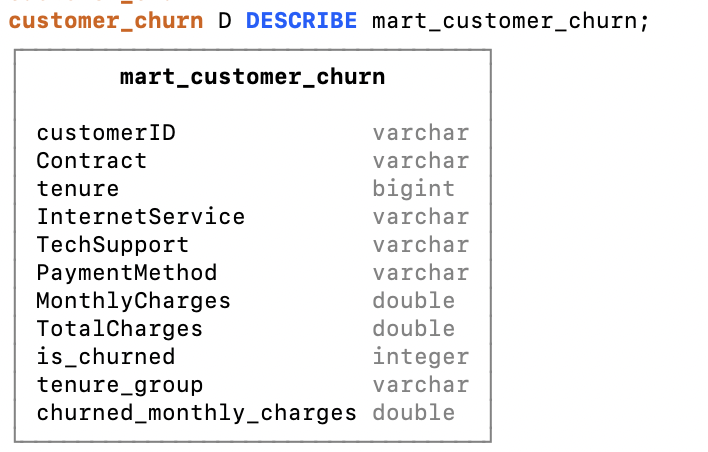
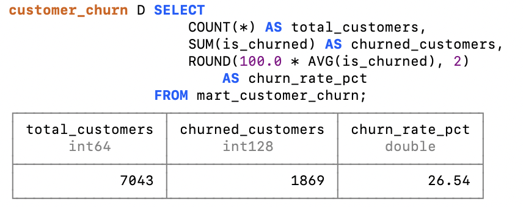
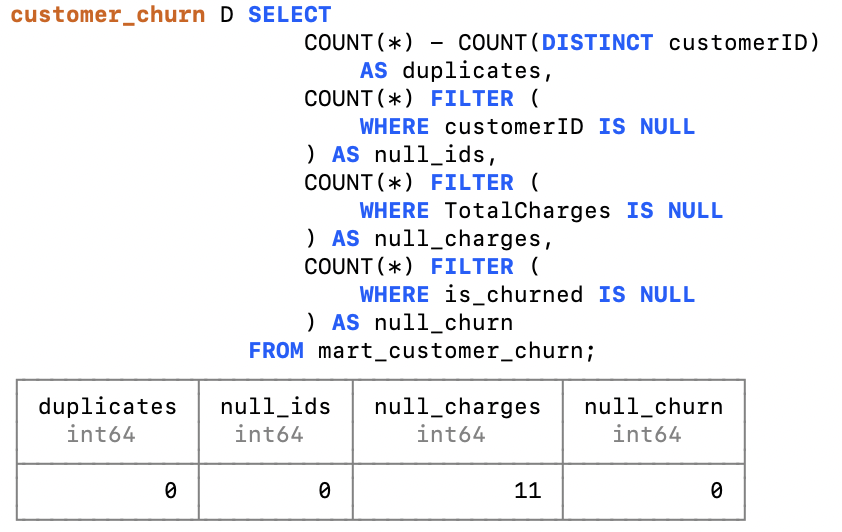

# Customer Retention & Churn Analytics

### Customer Churn Analysis | SQL (DuckDB) | Tableau Public | BI Data Mart

## Project Overview

This project analyzes customer churn, customer segments, and monthly charges using the Telco Customer Churn dataset.

The goal is to identify customer groups associated with higher churn rates, explore revenue-related retention opportunities, and communicate findings through interactive Tableau dashboards and SQL analysis.

The project also includes a customer-level analytical data mart developed in DuckDB, demonstrating SQL-based data preparation, customer segmentation, KPI validation, and data quality checks.

## Tools & Technologies

- **Tableau Public** — interactive dashboards, KPI calculations, and customer segmentation
- **SQL (DuckDB)** — analytical queries, data transformation, and data mart development
- **Data Quality Validation** — duplicate detection, missing value checks, and KPI reconciliation
- **GitHub** — SQL scripts, documentation, and project deliverables

## Dataset

**Dataset:** Telco Customer Churn

The dataset contains 7,043 customer records and 21 columns, including:

- Customer ID and demographic attributes
- Contract type and customer tenure
- Payment method
- Internet service and additional services
- Monthly and total charges
- Customer churn status

**Data granularity:** One row per customer.

## Interactive Tableau Dashboards

Explore the full interactive project on [Tableau Public](https://public.tableau.com/app/profile/sophia.bank/viz/CustomerRetentionChurnAnalytics/Dashboard1).

### 1. Customer Churn Overview

This dashboard presents key churn metrics and analyzes customer churn by contract type, tenure, and payment method.

### 2. Customer Segmentation

This dashboard explores churn patterns across internet service types, online security, technical support, and senior citizen segments.

### 3. Revenue & Retention Opportunities

This dashboard examines monthly charges, charges associated with churned customers, and revenue-related patterns across customer segments.

## Key Performance Indicators

| Metric | Value |
|---|---:|
| Total Customers | 7,043 |
| Churned Customers | 1,869 |
| Churn Rate | 26.54% |
| Total Monthly Charges | $456,116.60 |
| Average Monthly Charges | $64.76 |
| Monthly Charges of Churned Customers | $139,130.85 |

*Note: Monthly charges represent amounts recorded in the dataset, not verified revenue for a specific calendar month. The charges associated with churned customers are a descriptive measure, not confirmed realized revenue loss.*

## SQL Analysis

The project includes analytical SQL queries covering:

- Overall customer counts and churn rates
- Churn by contract type
- Churn by customer tenure
- Churn by payment method
- Monthly charges and churn-related revenue metrics
- Customer segments associated with higher churn

**SQL file:** [churn_analysis.sql](churn_analysis.sql)

## SQL Data Mart Development

In addition to the exploratory SQL analysis, a customer-level analytical data mart was developed using DuckDB.

The purpose of the data mart is to demonstrate SQL-based data preparation and modeling for BI reporting.

**Data mart:** `mart_customer_churn`  
**Database:** DuckDB  
**Granularity:** One row per customer  
**Source:** Telco Customer Churn CSV dataset

### Data Transformation

The SQL data mart performs the following transformations:

1. Loads the source CSV dataset into DuckDB.
2. Converts monthly and total charges into numeric data types.
3. Handles missing and non-numeric values in `TotalCharges`.
4. Creates a binary customer churn indicator (`is_churned`).
5. Segments customers into tenure groups (0–6, 7–12, 13–24, 25–48, and 49+ months).
6. Creates a measure representing monthly charges associated with churned customers.

These transformations produce a structured customer-level table suitable for further BI analysis.

**SQL script:** [create_customer_churn_mart.sql](create_customer_churn_mart.sql)

### Data Mart Structure

The analytical data mart contains customer attributes, segmentation fields, and calculated churn indicators.

Key derived fields include:

| Field | Description |
|---|---|
| `is_churned` | Binary churn indicator (1 = churned, 0 = retained) |
| `tenure_group` | Customer tenure segmentation |
| `churned_monthly_charges` | Monthly charges associated with churned customers |

### KPI Validation

The SQL data mart was validated against the overall customer churn metrics.

**Validated results:**

| Metric | Value |
|---|---:|
| Total Customers | 7,043 |
| Churned Customers | 1,869 |
| Churn Rate | 26.54% |

The validated values are consistent with the original dataset and the overall churn analysis.

## Data Quality Validation

Data quality checks were developed to assess the reliability and consistency of the prepared analytical dataset.

The checks cover:

- Duplicate customer IDs
- Missing customer identifiers
- Missing total charge values
- Missing churn indicators
- KPI consistency across the analytical data mart

**SQL script:** [data_quality_checks.sql](data_quality_checks.sql)

### Data Quality Results

The validation confirmed:

- No duplicate customer identifiers
- No missing customer IDs
- No missing churn indicators

The source dataset also contains missing values in `TotalCharges`, which are preserved as NULL rather than replaced with arbitrary values.

This approach keeps the original data limitations visible and avoids introducing unsupported assumptions.

## Key Insights

1. **Contract type:** Month-to-month customers have a substantially higher churn rate (42.7%) than customers with one-year (11.3%) or two-year contracts (2.8%).
2. **Customer tenure:** Customers with 0–6 months of tenure have a churn rate of approximately 52.9%, compared with 9.5% for customers with 49+ months of tenure.
3. **Payment method:** Customers using electronic checks have the highest observed churn rate among payment methods (45.3%).
4. **Internet service:** Fiber optic customers have a churn rate of approximately 41.9%, compared with 19.0% for DSL customers.
5. **Monthly charges:** Customers who churned have higher average monthly charges (approximately $74.44) than customers who stayed (approximately $61.27).

These findings describe associations in the dataset and do not establish causation.

## Business Recommendations

Based on the observed patterns, potential areas for further investigation include:

- **New customer retention:** Evaluate onboarding and early engagement initiatives for customers within their first six months.
- **Contract optimization:** Test retention offers and longer-term contract incentives for month-to-month subscribers.
- **Service experience:** Investigate customer satisfaction and pricing perceptions among fiber optic subscribers.
- **Payment behavior:** Examine the relationship between payment methods and churn while accounting for other customer characteristics.

These recommendations represent hypotheses for further analysis and testing rather than proven interventions.

## Project Architecture

The project demonstrates two complementary BI workflows.

**SQL Data Preparation:**

`Source CSV → DuckDB → SQL Transformations → Customer Churn Data Mart → Data Quality Validation`

**Dashboard Development:**

`Source CSV → Tableau Public → Interactive Dashboards → Business Insights`

*The Tableau dashboards were developed independently using the original dataset. The SQL data mart is provided as a separate BI development component and is not the underlying source of the published dashboards.*

## How to Reproduce the SQL Analysis

1. Download the Telco Customer Churn CSV dataset.
2. Install DuckDB.
3. Place the source CSV in the working directory, using the filename referenced in the SQL script, or update the CSV file path.
4. Open DuckDB and execute `create_customer_churn_mart.sql`.
5. Execute `data_quality_checks.sql` to validate the resulting data mart.
6. Run `churn_analysis.sql` to explore additional analytical queries.

The SQL scripts are designed to run in DuckDB.

## Project Deliverables

- Three interactive Tableau dashboards
- Exploratory SQL analysis
- Customer-level SQL analytical data mart
- Data quality and KPI validation queries
- SQL execution screenshots
- Customer churn insights and business recommendations
- GitHub project documentation

## Skills Demonstrated

**SQL & Data Preparation:** Data type conversion, CTEs, conditional logic, aggregations, customer segmentation, and analytical data mart development.

**Data Quality:** Duplicate detection, missing value assessment, and KPI reconciliation.

**BI & Visualization:** KPI design, interactive dashboard development, customer segmentation, and business-oriented reporting.

**Business Analytics:** Churn analysis, retention opportunity identification, and data-driven recommendations.
